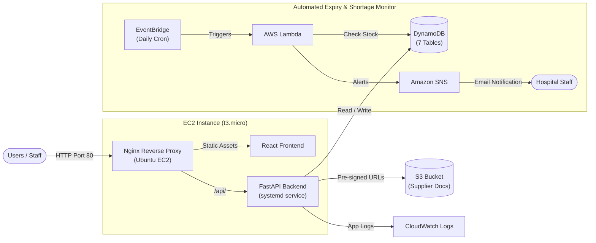
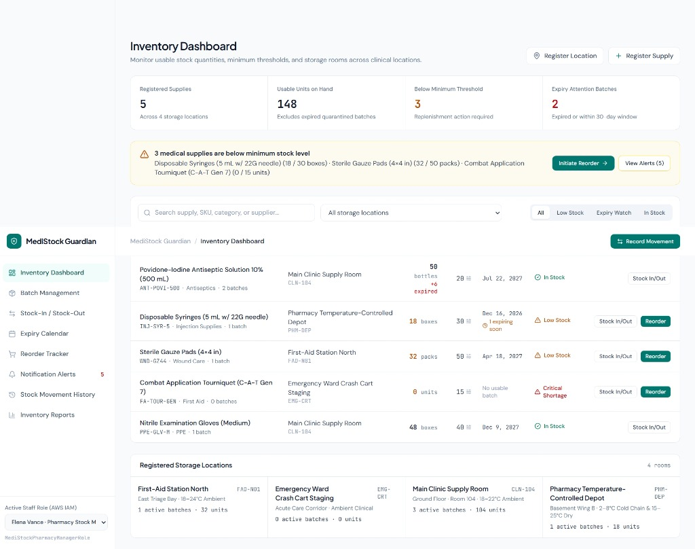
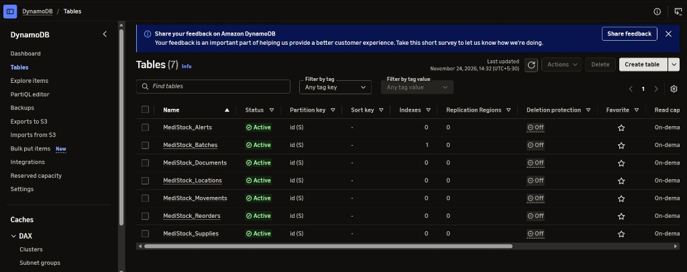
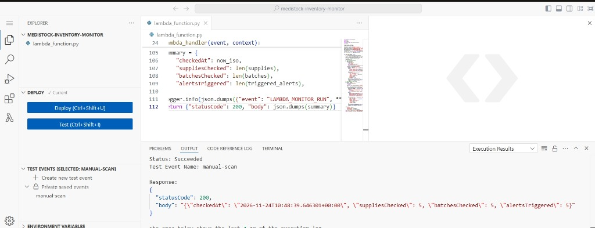

# MediStock Guardian – AWS Cloud Infrastructure

[-FF9900?logo=amazon-aws&logoColor=white)](https://aws.amazon.com/)
[](https://ubuntu.com/)
[](https://nginx.org/)
[](https://aws.amazon.com/dynamodb/)
[](https://aws.amazon.com/lambda/)

Production AWS cloud infrastructure and automated monitoring for a full-stack medical inventory tracking application deployed in **AWS Asia Pacific (Hyderabad – `ap-south-2`)**.

---

## Architecture Diagram



---

## How It Works (Simple Overview)

* **EC2 & Nginx:** A single Ubuntu `t3.micro` instance hosts the app. Nginx serves the frontend web pages and forwards API calls to the backend on port `8000`.
* **systemd Service:** The Python API runs as a systemd background service (`medistock-api.service`) so it automatically starts on boot and restarts if it fails.
* **IAM Security (No hardcoded keys):** The EC2 instance and Lambda function use IAM Roles to talk to DynamoDB, S3, SNS, and CloudWatch without saving any access keys on the server.
* **DynamoDB:** Stores all locations, supplies, batches, movements, reorders, alerts, and documents across 7 tables.
* **Amazon S3:** Stores uploaded supplier PDF/image documents privately. Users access them via secure, temporary pre-signed links.
* **Daily Cron Monitor (EventBridge + Lambda + SNS):** Runs every day at `07:00 UTC` to check for low stock or items expiring within 30 days. If an item is low or expiring, Lambda sends an email alert to staff via SNS.
* **CloudWatch:** Captures server and monitoring logs in one place for troubleshooting.

---

## Repository Structure

```text
├── aws/
│   ├── ec2/deploy.sh               # EC2 package setup and build script
│   ├── iam/medistock-policy.json   # IAM least-privilege security policy
│   ├── lambda/inventory_monitor.py # Scheduled stock & expiry monitor
│   └── vpc/vpc-setup.md            # Network & Security Group guide
├── docs/
│   ├── DEPLOYMENT.md               # Step-by-step production runbook
│   └── screenshots/                # Live proof from AWS console & app
├── backend-python/                 # Python FastAPI backend service
├── src/                            # React dashboard frontend
└── .env.example                    # Environment variable template
```

---

## Deployment Summary

For full setup commands, see the **[Production Deployment Runbook](docs/DEPLOYMENT.md)**.

1. **Launch EC2:** Ubuntu 24.04 `t3.micro` in `ap-south-2` with Security Group allowing port 80 (HTTP) and port 22 (SSH).
2. **Attach IAM Role:** Attach `MediStockEC2Role` to the EC2 instance for keyless AWS access.
3. **Run Setup:** Clone repo and run `./aws/ec2/deploy.sh` to install dependencies and build the app.
4. **Start systemd Service:** Enable and start `medistock-api.service`.
5. **Start Nginx:** Configure reverse proxy to route web traffic to the app.
6. **Set up EventBridge:** Schedule the Lambda function daily (`cron(0 7 * * ? *)`) to send alerts via SNS.

---

## Live Deployment Proof (`ap-south-2`)

| **Live Dashboard on EC2 + Nginx** | **7 Active DynamoDB Tables (`ap-south-2`)** |
|:---:|:---:|
|  |  |
| **Scheduled Lambda + EventBridge Scan** | **Automated Amazon SNS Email Notification** |
|  |  |

---

## Author

**Mohammed Anasullah Khan**  
*AWS Cloud & DevOps Engineer | Hyderabad, India*

- **Portfolio:** [https://mohdanaskhan01.github.io/anasullah-portfolio/](https://mohdanaskhan01.github.io/anasullah-portfolio/)
- **GitHub:** [https://github.com/mohdanaskhan01](https://github.com/mohdanaskhan01)
- **LinkedIn:** [https://www.linkedin.com/in/mohammed-anasullah-khan/](https://www.linkedin.com/in/mohammed-anasullah-khan/)
