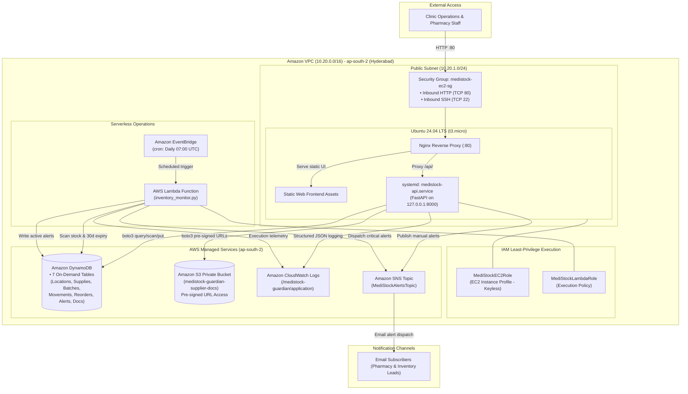
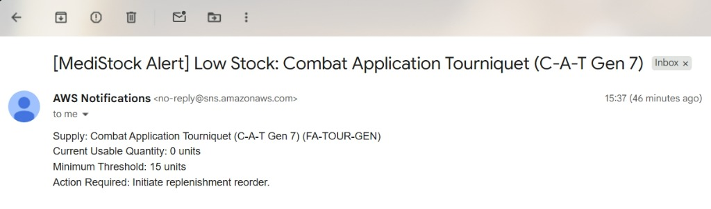

# MediStock Guardian – AWS Cloud Infrastructure, Deployment & Serverless Operations

[-FF9900?logo=amazon-aws&logoColor=white)](https://aws.amazon.com/)
[](https://ubuntu.com/)
[](https://nginx.org/)
[-4053D6?logo=amazondynamodb&logoColor=white)](https://aws.amazon.com/dynamodb/)
[](https://aws.amazon.com/lambda/)

> **Project Scope & Contribution:**
> This repository documents the production AWS cloud architecture, server provisioning, security hardening, and serverless automation implemented by **Mohammed Anasullah Khan** for a pre-built full-stack medical inventory and expiry tracking system. 
> 
> All infrastructure, networking, least-privilege IAM policies, systemd process management, Nginx reverse proxy configuration, and automated event-driven Lambda monitors were architected, deployed, and verified live in **AWS Asia Pacific (Hyderabad – `ap-south-2`)**.

---

## Cloud Architecture (`ap-south-2`)



---

## AWS & Linux Engineering Highlights

### 1. Compute & Reverse Proxy (`EC2` + `Nginx` + `systemd`)
- **Host Sizing & Memory Tuning:** Provisioned an AWS EC2 `t3.micro` instance running **Ubuntu 24.04 LTS** in `ap-south-2`. Configured a 1 GB swap file (`/swapfile`) with `vm.swappiness=10` to maintain OS responsiveness and prevent out-of-memory kernel panics during frontend build operations.
- **Nginx Reverse Proxy:** Configured Nginx to listen on port `80`, serve the optimized production static web build directly from the filesystem, and reverse-proxy all dynamic API calls (`/api/`) internally to `http://127.0.0.1:8000`.
- **Process Supervision (`systemd`):** Configured and enabled `medistock-api.service` under `systemd` to supervise the Python backend process, enforce zero-downtime automatic restarts on failure (`Restart=always`, `RestartSec=5s`), and capture stdout/stderr to syslog.

### 2. Zero-Credential IAM Security (`IAM`)
- **Keyless Runtime Architecture:** Eliminated permanent, static AWS access keys (`AWS_ACCESS_KEY_ID`, `AWS_SECRET_ACCESS_KEY`) from the production server.
- **Instance Profile & Scoped Policies:** Created and attached the `MediStockEC2Role` IAM role via an EC2 Instance Profile. Both the EC2 instance and the Lambda function assume scoped, least-privilege IAM policies (`aws/iam/medistock-policy.json`) strictly limited to the required DynamoDB table ARNs, private S3 bucket, CloudWatch log group, and SNS topic ARN.

### 3. Network & Perimeter Hardening (`VPC` & `Security Groups`)
- **Strict Inbound Firewall:** Hardened `medistock-ec2-sg` to restrict inbound network traffic exclusively to `TCP 80` (HTTP web traffic) and `TCP 22` (SSH administrative access restricted to administrator IP).
- **Internal Port Isolation:** Completely blocked public internet access to application backend ports (`8000` and `3000`), ensuring backend services bind exclusively to localhost and are reachable only via the local Nginx proxy.

### 4. Cloud Storage & NoSQL Provisioning (`DynamoDB` & `S3`)
- **7 On-Demand DynamoDB Tables:** Provisioned seven dedicated tables with single-table partition key schemas (`id: string`) and Pay-Per-Request (On-Demand) capacity mode for optimal cost efficiency:
  - `MediStock_Locations`
  - `MediStock_Supplies`
  - `MediStock_Batches`
  - `MediStock_Movements`
  - `MediStock_Reorders`
  - `MediStock_Alerts`
  - `MediStock_Documents`
- **Private S3 Bucket with Pre-Signed URLs:** Created a private Amazon S3 bucket (`medistock-guardian-supplier-docs`) with public access blocked. All supplier documentation (invoices, certificates, safety data sheets) is uploaded and retrieved through secure, time-limited IAM-generated pre-signed URLs.

### 5. Serverless Automated Monitoring (`Lambda` + `EventBridge` + `SNS`)
- **Scheduled Expiry & Shortage Scanning:** Configured an Amazon EventBridge rule running on a daily cron expression (`cron(0 7 * * ? *)`) to trigger an autonomous AWS Lambda function (`aws/lambda/inventory_monitor.py`).
- **Real-Time Notification Pipeline:** The Lambda function evaluates usable inventory across all locations against configured minimum stock levels and detects batches within the 30-day expiration window. Any triggered alerts are committed to `MediStock_Alerts` and instantly published via **Amazon SNS** (`MediStockAlertsTopic`) to alert pharmacy managers via email.

### 6. Centralized Observability (`CloudWatch`)
- Configured structured JSON application logging to CloudWatch Logs group `/medistock-guardian/application`.
- Captured both API transaction logs and Lambda monitoring execution summaries (`suppliesChecked`, `batchesChecked`, `alertsTriggered`) for auditable tracking and operational troubleshooting.

---

## Repository & Infrastructure Layout

```text
├── aws/
│   ├── ec2/
│   │   └── deploy.sh               # Ubuntu host package installation, build & setup runbook
│   ├── iam/
│   │   └── medistock-policy.json   # Least-privilege IAM policy (DynamoDB, S3, SNS, CloudWatch)
│   ├── lambda/
│   │   └── inventory_monitor.py    # Autonomous EventBridge-scheduled inventory & expiry scanner
│   └── vpc/
│       └── vpc-setup.md            # VPC subnet allocation, gateway endpoints & security group spec
├── docs/
│   └── screenshots/                # Verified live AWS deployment evidence (ap-south-2)
│       ├── 01-live-dashboard.jpg
│       ├── 02-dynamodb-tables.jpg
│       ├── 03-lambda-eventbridge.jpg
│       └── 04-sns-alert.jpeg
├── backend-python/                 # Pre-built Python FastAPI runtime service (port 8000)
├── src/                            # Pre-built React + Vite web dashboard UI
├── server.ts                       # Alternative Express runtime layer
├── .env.example                    # Clean, sanitized environment configuration template
└── .gitignore                      # Hardened ignore rules preventing secret or artifact leaks
```

---

## Production Deployment Runbook

### 1. Provision EC2 Host & Prepare Swap
```bash
# Connect to your Ubuntu 24.04 LTS instance in ap-south-2
ssh -i your-key.pem ubuntu@<EC2_PUBLIC_IP>

# Configure 1 GB swap space to support memory overhead during builds
sudo fallocate -l 1G /swapfile
sudo chmod 600 /swapfile
sudo mkswap /swapfile
sudo swapon /swapfile
echo '/swapfile none swap sw 0 0' | sudo tee -a /etc/fstab
```

### 2. Clone Repository & Run Host Setup
```bash
git clone https://github.com/mohdanaskhan01/medistock-guardian-medical-supply-tracker.git
cd medistock-guardian-medical-supply-tracker

# Run the deployment setup script
chmod +x aws/ec2/deploy.sh
./aws/ec2/deploy.sh
```

### 3. Configure Keyless Production Environment
```bash
# Copy template — IAM role handles AWS authentication automatically
cp .env.example .env

# Verify environment configuration
cat << 'EOF' > .env
USE_AWS=true
AWS_REGION=ap-south-2

DYNAMODB_LOCATIONS_TABLE=MediStock_Locations
DYNAMODB_SUPPLIES_TABLE=MediStock_Supplies
DYNAMODB_BATCHES_TABLE=MediStock_Batches
DYNAMODB_MOVEMENTS_TABLE=MediStock_Movements
DYNAMODB_REORDERS_TABLE=MediStock_Reorders
DYNAMODB_ALERTS_TABLE=MediStock_Alerts
DYNAMODB_DOCUMENTS_TABLE=MediStock_Documents

S3_DOCUMENTS_BUCKET=medistock-guardian-supplier-docs
SNS_ALERTS_TOPIC_ARN=arn:aws:sns:ap-south-2:123456789012:MediStockAlertsTopic
CLOUDWATCH_LOG_GROUP=/medistock-guardian/application
EOF
```

### 4. Configure `systemd` Service
```bash
sudo tee /etc/systemd/system/medistock-api.service > /dev/null << 'EOF'
[Unit]
Description=MediStock Guardian FastAPI Application
After=network.target

[Service]
User=ubuntu
WorkingDirectory=/home/ubuntu/medistock-guardian-medical-supply-tracker/backend-python
ExecStart=/home/ubuntu/medistock-guardian-medical-supply-tracker/backend-python/.venv/bin/uvicorn main:app --host 127.0.0.1 --port 8000
Restart=always
RestartSec=5s
EnvironmentFile=/home/ubuntu/medistock-guardian-medical-supply-tracker/.env

[Install]
WantedBy=multi-user.target
EOF

sudo systemctl daemon-reload
sudo systemctl enable --now medistock-api.service
sudo systemctl status medistock-api.service --no-pager
```

### 5. Configure Nginx Reverse Proxy
```bash
sudo tee /etc/nginx/sites-available/medistock > /dev/null << 'EOF'
server {
    listen 80;
    server_name _;

    # Static frontend assets built by Vite
    root /home/ubuntu/medistock-guardian-medical-supply-tracker/dist;
    index index.html;

    location / {
        try_files $uri $uri/ /index.html;
    }

    # Internal API reverse proxy
    location /api/ {
        proxy_pass http://127.0.0.1:8000;
        proxy_http_version 1.1;
        proxy_set_header Host $host;
        proxy_set_header X-Real-IP $remote_addr;
        proxy_set_header X-Forwarded-For $proxy_add_x_forwarded_for;
        proxy_set_header X-Forwarded-Proto $scheme;
    }
}
EOF

sudo ln -sf /etc/nginx/sites-available/medistock /etc/nginx/sites-enabled/
sudo rm -f /etc/nginx/sites-enabled/default
sudo nginx -t && sudo systemctl restart nginx
```

### 6. Attach EventBridge Scheduled Rule to Lambda
```bash
# Create the daily cron rule (triggers at 07:00 UTC)
aws events put-rule \
    --name MediStockDailyInventoryScan \
    --schedule-expression "cron(0 7 * * ? *)" \
    --region ap-south-2

# Add permission for EventBridge to invoke Lambda
aws lambda add-permission \
    --function-name mediStock-inventory-monitor \
    --statement-id EventBridgeDailyScan \
    --action 'lambda:InvokeFunction' \
    --principal events.amazonaws.com \
    --source-arn arn:aws:events:ap-south-2:123456789012:rule/MediStockDailyInventoryScan \
    --region ap-south-2

# Associate target Lambda function with the EventBridge rule
aws events put-targets \
    --rule MediStockDailyInventoryScan \
    --targets "Id"="1","Arn"="arn:aws:lambda:ap-south-2:123456789012:function:mediStock-inventory-monitor" \
    --region ap-south-2
```

---

## Live Deployment Verification (`ap-south-2`)

| **Live Dashboard on EC2 + Nginx** | **7 Active DynamoDB Tables (`ap-south-2`)** |
|:---:|:---:|
|  |  |
| *Production web UI served via Nginx on Ubuntu 24.04 EC2* | *7 On-Demand tables provisioned in Asia Pacific (Hyderabad)* |
| **Scheduled Lambda + EventBridge Scan** | **Automated Amazon SNS Email Notification** |
|  |  |
| *Automated test run: 5 supplies & 5 batches scanned, 5 alerts logged* | *Real-time shortage alert dispatched to staff subscriber inbox* |

---

> **Live System Walkthrough:** A screen recording demonstrating the live UI on EC2 interacting with the AWS backend and recording real-time inventory adjustments is included in [docs/medistock-demo.mp4](docs/medistock-demo.mp4).

---

## Author

**Mohammed Anasullah Khan**  
*AWS Cloud & DevOps Engineer | Hyderabad, India*

- **Portfolio:** [https://mohdanaskhan01.github.io/anasullah-cloud-devops-portfolio/](https://mohdanaskhan01.github.io/anasullah-cloud-devops-portfolio/)
- **GitHub:** [https://github.com/mohdanaskhan01](https://github.com/mohdanaskhan01)
- **LinkedIn:** [https://www.linkedin.com/in/mohammed-anasullah-khan/](https://www.linkedin.com/in/mohammed-anasullah-khan/)
